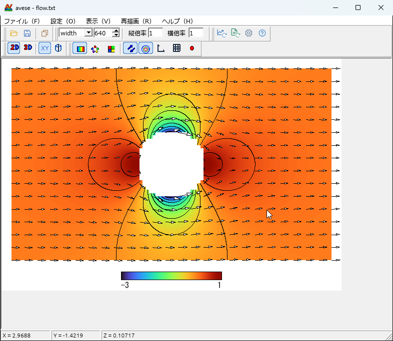
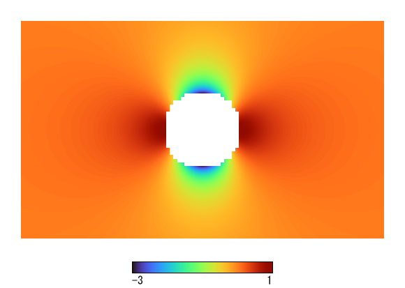
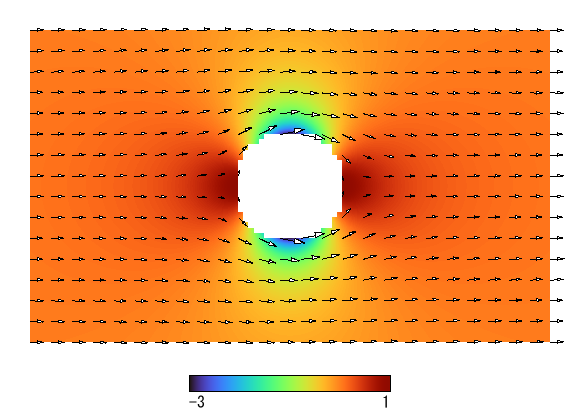
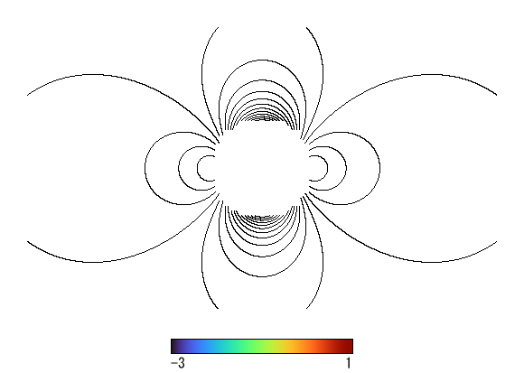
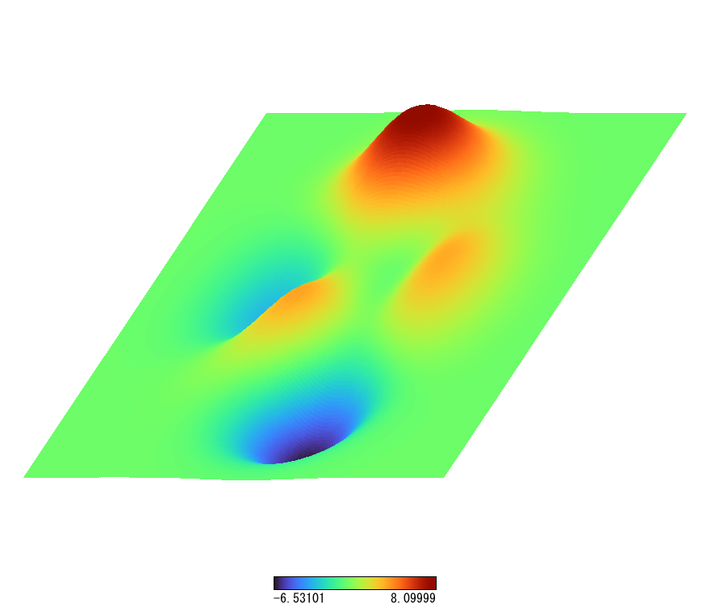
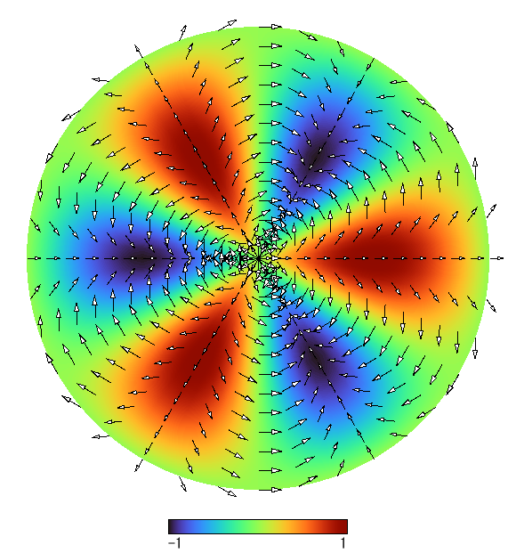
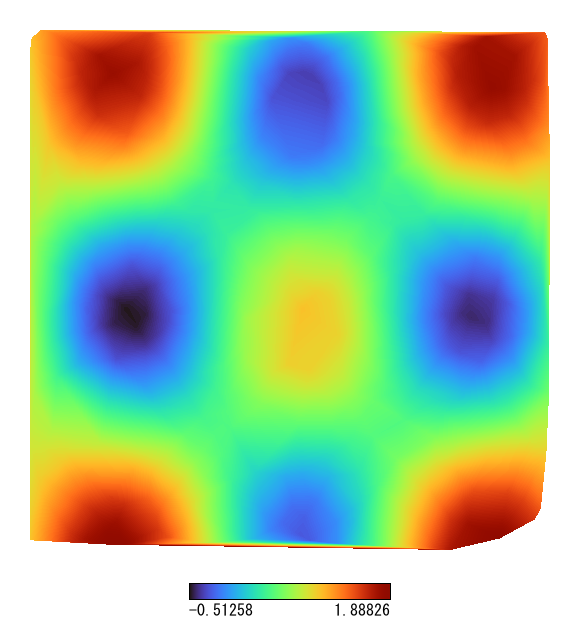

# avese

English | [日本語](README.ja.md)

avese turns 3D data from numerical simulations and measurements into distribution plots, vector plots, contour plots and bird's-eye views. Drop a text file onto the window and the plot appears.

**[User guide with videos](http://o-server.main.jp/avese/)** ・ **[Download](https://github.com/tetsuji16/avese/releases/latest)**

[](http://o-server.main.jp/avese/#start)

| Distribution | Vectors | Contours |
|:---:|:---:|:---:|
|  |  |  |
| **Bird's-eye view** | **Cylindrical** | **Triangular mesh** |
|  |  |  |

## Get started

1. Download the Windows (x64) ZIP from the [latest release](https://github.com/tetsuji16/avese/releases/latest), extract it and run `avese.exe`. Nothing needs to be installed. On other OSes, [build from source](#build).
2. Drag and drop a data file onto the window. [Sample data](http://o-server.main.jp/avese/samples/samples.zip) is available to try.
3. Switch the plot in the toolbar and press Redraw. Changes in the settings dialog take effect with OK.
4. Save the image with Save. Drop several files together to open Batch Processing, which makes BMP files or an AVI.

Data is text, one data point per line. Separate values with spaces, tabs or commas.

```
# X  Y  Z  U  V
0  0  1.5  0.2  0.1
1  0  1.8  0.3  0.1
```

Column assignment, holes, labels and embedded settings are explained in the [user guide](http://o-server.main.jp/avese/#data).

## Features

- **Data**: grids, triangular meshes (automatic Delaunay), panels. Embedded settings, `IncludeINI`, `Labels`, Shift-JIS and UTF-8.
- **Plan views**: distribution (linear, cubic spline), scatter, panel, vectors, contours. Cartesian and cylindrical coordinates.
- **Bird's-eye view**: surface and grid lines, adjustable viewpoint.
- **Decoration**: axes, grid, ticks, data points, legend, labels, nine color scales (the default is Google's Turbo).
- **Output**: BMP (8-bit, RLE8), PNG, EMF, WMF, uncompressed 8-bit AVI, clipboard (DIB, enhanced metafile). Batch creation of BMP and AVI.
- **GUI**: menus, toolbars, settings dialog, batch processing, label editing, progress display, coordinates in the status bar, drag and drop, INI load and save, built-in help.

The interface switches between Japanese and English automatically. Windows uses the user's regional setting, macOS uses AppleLocale, and Linux and Unix use `LC_ALL`, `LC_MESSAGES` and `LANG`. Anything that is not English is shown in Japanese.

The design is described in [docs/RENDERING.md](docs/RENDERING.md) (Japanese). Pixel-exact agreement with the original is not a goal.

## Command line

```
avese data.txt
avese --render data.txt out.png [--rle] [--ini settings.ini] [--set key=value]...
avese --avi out.avi --fps 10 [--frame-size 320x240] [--ini settings.ini] [--set key=value]... data1.txt data2.txt ...
```

The format of `--render` output follows the extension (`.png`, `.bmp`, `.emf`, `.wmf`).

Loaded point data can be turned into a triangular mesh with Redraw → Generate triangular mesh, or by writing `Mesh AutoCreate` in the data.

## Build

```
cargo build --release
cargo test
```

The user guide lives in [site/](site/).

Original samples are not part of this repository. See [README.ja.md](README.ja.md) for how to run the tests that compare against them, for extracting assets from a local copy of the original, and for the list of known differences.

## License

[MIT License](LICENSE).

- Assets of the original software are not covered by the MIT license. Do not add the original exe, help, samples or extracted images to this repository (they are in `.gitignore`).
- Fonts such as MS Gothic are not bundled. avese searches the installed fonts at run time and uses a Japanese font.
- General-purpose toolbar icons use [Phosphor Icons](https://phosphoricons.com/) (MIT).
- Contour tracing uses the [contour](https://crates.io/crates/contour) crate, and the Turbo colors use [colorous](https://crates.io/crates/colorous).

---

<sub>avese is a Rust rewrite of AV似非 (a simplified version of AVS). It is not affiliated with the developers of AVS or AV似非.</sub>
